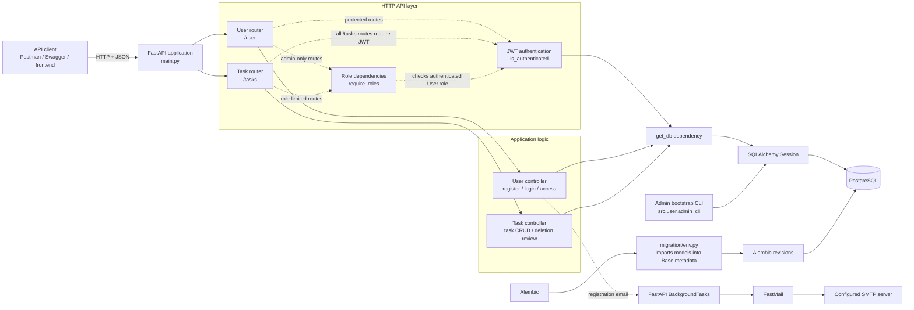
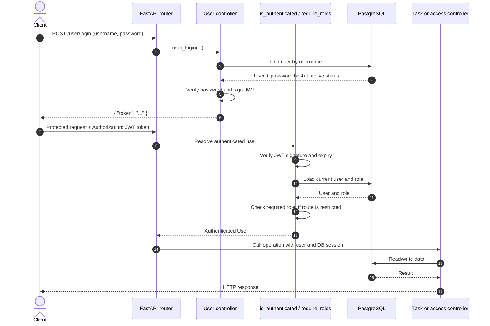
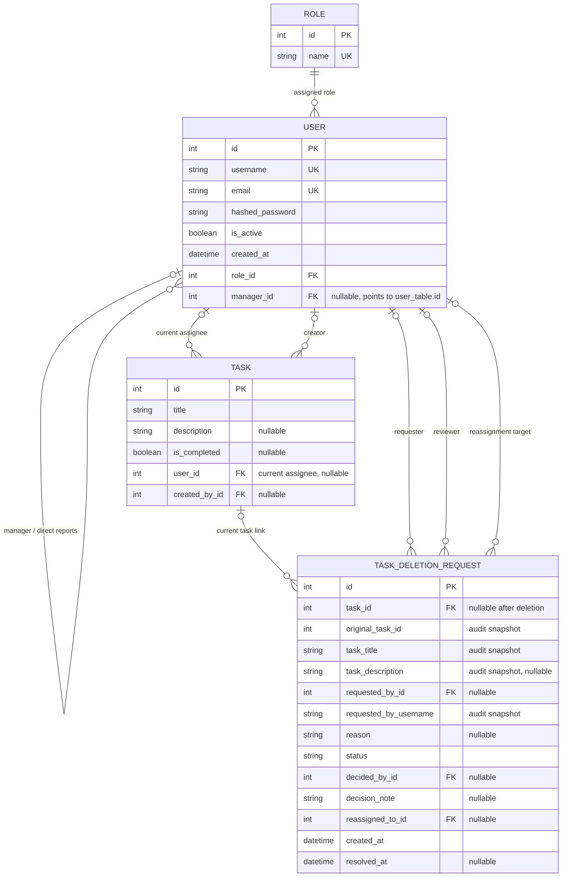
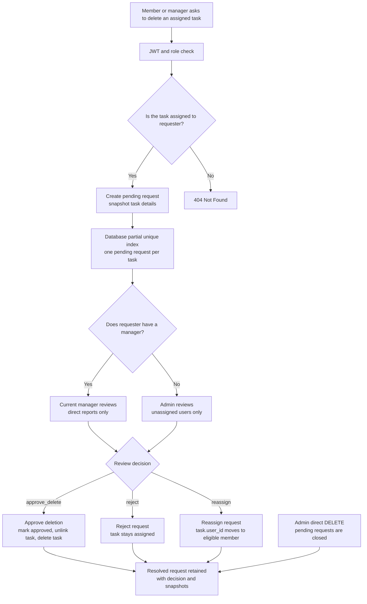
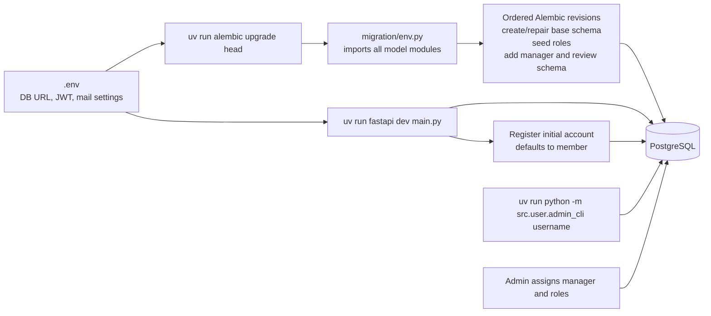

# Task Management API architecture

This document describes the current implementation: the request path, authentication and authorization, database relationships, task deletion review workflow, and application setup.

## 1. Runtime components

### Request handling

1. `main.py` creates the FastAPI app and includes the user and task routers. It does not create or migrate database tables at startup.
2. FastAPI validates request bodies with Pydantic DTOs and injects a database session through `get_db`.
3. **Every `/tasks` route requires authentication.** The client sends `Authorization: JWT <token>`; `is_authenticated` verifies the token and loads the current `User` from PostgreSQL. There are no public task endpoints.
4. Role-restricted routes use `require_roles`. The user's role is read from the database, rather than trusted from a JWT role claim.
5. Router functions call the corresponding controller. Controllers enforce task ownership and workflow rules, then read or update SQLAlchemy models.
6. `get_db` closes the request's SQLAlchemy session when the request finishes.

Registration hashes passwords with `pwdlib` and queues a welcome email with FastAPI `BackgroundTasks`. Email delivery is handled by `FastMail` and the configured SMTP server.

### Task endpoint access

Every endpoint below requires a valid `Authorization: JWT <token>` header. Routes with a role restriction also return `403 Forbidden` when the authenticated user's role is not allowed.

| Method | Endpoint | Allowed role(s) |
| --- | --- | --- |
| `POST` | `/tasks/create` | Any authenticated user |
| `GET` | `/tasks/all-tasks` | Any authenticated user |
| `GET` | `/tasks/task/{task_id}` | Any authenticated user |
| `PUT` | `/tasks/task/{task_id}` | Any authenticated user |
| `DELETE` | `/tasks/task/{task_id}` | `admin` |
| `POST` | `/tasks/task/{task_id}/deletion-requests` | `member`, `manager` |
| `GET` | `/tasks/deletion-requests` | `manager`, `admin` |
| `POST` | `/tasks/deletion-requests/{request_id}/decision` | `manager`, `admin` |

## 2. Authentication and authorization

The JWT contains the user's identity and expiry. It does not carry an authoritative role; role changes in the database therefore take effect on subsequent requests without trusting a stale role claim.

### Role responsibilities

| Role | Main capabilities |
| --- | --- |
| `member` | Create, view, and update tasks assigned to them; request review to delete an assigned task. Cannot directly delete tasks. |
| `manager` | Member capabilities plus review requests from their direct reports and reassign a task to another eligible active member they manage. |
| `admin` | Assign roles and managers, list users and roles, directly delete tasks, and review requests from users with no manager. |

Public registration always assigns `member`. The built-in role records are seeded by the migration. An administrator assigns a role and an optional `manager_id` through `PATCH /user/users/{user_id}/access`. The first administrator is bootstrapped by promoting an existing account with `uv run python -m src.user.admin_cli <username>`.

## 3. Database relationships

### Relationship details

- `USER.role_id` points to one built-in role.
- `USER.manager_id` is a nullable self-reference. One user has at most one manager; one manager can have many direct reports. A manager assignment must reference an active user with the manager role, and the API rejects cycles.
- `TASK.user_id` identifies the task's current assignee. Reassignment changes this field. `created_by_id` retains the creator separately.
- A deletion request snapshots task and requester details so the review history remains useful after the task is deleted. On approval, `task_id` is set to `NULL`, `original_task_id` remains, then the task is deleted.
- A partial unique index permits at most one `pending` deletion request per task. Resolved requests remain as audit records.

## 4. Task deletion review flow

### Review rules

1. Members and managers may request deletion only for a task currently assigned to themselves.
2. Direct `DELETE /tasks/task/{task_id}` is restricted to administrators. Members and managers receive `403` and must use the review endpoint.
3. A manager can list and decide requests only for users whose current `manager_id` points to that manager. If a member's manager changes while a request is pending, the new manager owns the review.
4. A manager may reassign only to another active member they manage. An administrator handling an unassigned requester may reassign to any active member.
5. A pending request can be resolved once. Repeating a decision returns a conflict rather than applying a second action.

### Workflow endpoints

| Operation | Endpoint |
| --- | --- |
| Submit deletion request | `POST /tasks/task/{task_id}/deletion-requests` |
| List review requests (pending by default) | `GET /tasks/deletion-requests?status=pending` |
| Decide (approve, reject, or reassign) | `POST /tasks/deletion-requests/{request_id}/decision` |
| Admin-only direct delete | `DELETE /tasks/task/{task_id}` |

## 5. Schema setup and supporting processes

The intended order is to create/configure the PostgreSQL database, run Alembic migrations, start the FastAPI server, register the initial account, and promote that account to admin with the CLI. The CLI promotes an existing user; it does not create a user. Later role and manager assignments are performed through the authenticated admin API.

## 6. Code map

| Area | Main files |
| --- | --- |
| App and routers | [`main.py`](../main.py), [`src/user/user_router.py`](../src/user/user_router.py), [`src/tasks/task_router.py`](../src/tasks/task_router.py) |
| Authentication and role guards | [`src/utils/helpers.py`](../src/utils/helpers.py) |
| User and role operations | [`src/user/user_controller.py`](../src/user/user_controller.py), [`src/user/user_models.py`](../src/user/user_models.py), [`src/user/user_dtos.py`](../src/user/user_dtos.py) |
| Task and deletion-review operations | [`src/tasks/task_controller.py`](../src/tasks/task_controller.py), [`src/tasks/task_models.py`](../src/tasks/task_models.py), [`src/tasks/task_dtos.py`](../src/tasks/task_dtos.py) |
| Database session and settings | [`src/utils/db.py`](../src/utils/db.py), [`src/utils/settings.py`](../src/utils/settings.py) |
| Email | [`src/utils/mail.py`](../src/utils/mail.py) |
| Admin bootstrap | [`src/user/admin_cli.py`](../src/user/admin_cli.py) |
| Migration configuration and revisions | [`migration/env.py`](../migration/env.py), [`migration/versions/`](../migration/versions/) |
